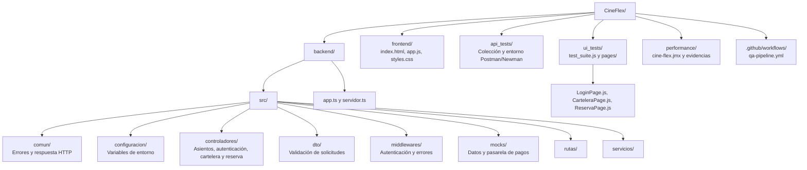
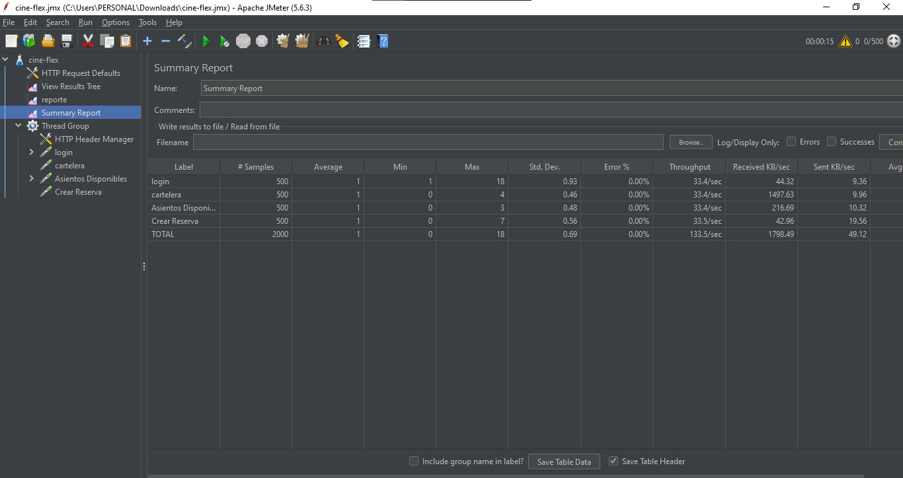
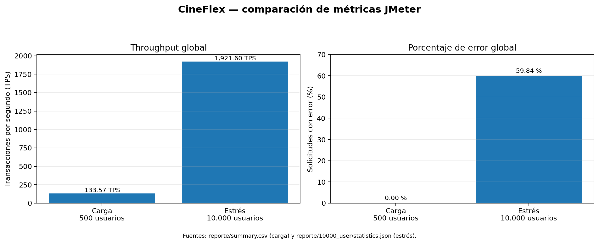
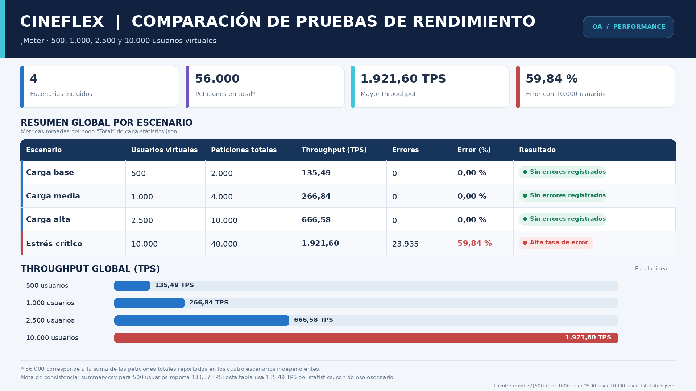

# CineFlex - QA en Producción


CineFlex es una aplicación web de demostración para validar el flujo de inicio de sesión, consulta de cartelera, selección de asientos y reserva con una pasarela de pago simulada.


## 1. Sustentación del Proyecto

- [Ver Video de Sustentación en YouTube](https://youtu.be/uDjASIP_Y9E)

## 2. Contexto y Arquitectura de Componentes

CineFlex es una aplicación de pruebas para el flujo de reserva de cine. El backend expone una API HTTP implementada con Express y TypeScript, sirve los archivos estáticos del frontend y utiliza datos en memoria junto con una pasarela de pagos simulada.

La organización existente del repositorio es la siguiente:



### Componentes y flujo funcional

1. El backend sirve la interfaz web y publica la API en el puerto configurado por `PORT`.
2. `POST /login` valida las credenciales de demostración y entrega un JWT.
3. `GET /cartelera` requiere un token Bearer válido; `GET /asientos/disponibles` consulta asientos disponibles y admite el parámetro opcional `funcionId`.
4. `POST /reserva` y `POST /pagos/mock` validan los datos y ejecutan el procesamiento de pago simulado.
5. `api_tests/` contiene la colección Postman para probar los contratos HTTP, `ui_tests/` automatiza los flujos de navegador y `performance/` contiene el plan JMeter.

### Rutas HTTP presentes

| Método | Ruta | Control de acceso | Propósito |
|---|---|---|---|
| `GET` | `/health` | Público | Informa la disponibilidad del servicio. |
| `POST` | `/login` | Público | Valida el inicio de sesión y devuelve el JWT. |
| `GET` | `/cartelera` | Bearer JWT | Consulta la cartelera simulada. |
| `GET` | `/asientos/disponibles` | Público | Consulta asientos disponibles; acepta `funcionId`. |
| `POST` | `/reserva` | Bearer JWT | Procesa una reserva mediante la pasarela simulada. |
| `POST` | `/pagos/mock` | Bearer JWT | Procesa un pago simulado. |

## 3. Requisitos Previos e Instalación Paso a Paso

### Runtimes y herramientas

| Herramienta | Versión o referencia presente en los archivos | Uso |
|---|---|---|
| Node.js | `20` configurado en GitHub Actions | Ejecutar el backend y las suites JavaScript. |
| npm | Gestor asociado a Node.js | Instalar dependencias y ejecutar scripts. |
| Git | Requerido para descargar y versionar el repositorio | Control del código fuente. |
| Google Chrome | La suite lo requiere| Navegador automatizado en modo headless. |
| ChromeDriver | `^140.0.0` en `ui_tests/package.json` | Control del navegador. |
| Selenium WebDriver | `^4.35.0` en `ui_tests/package.json` | Automatización de interfaz mediante POM. |
| Newman | `^6.2.1` en `api_tests/package.json` | Ejecutar la colección Postman desde consola. |
| Apache JMeter | `5.6.3` en `performance/cine-flex.jmx` | Ejecutar pruebas de carga y estrés. |
| Java | Requerido para ejecutar JMeter; Java Runtime Environment 8 | Runtime de JMeter. |

### Instalación secuencial

**Paso 1. Obtenga el repositorio.** Use la URL asignada al proyecto.

**Paso 2. Configure el entorno en la raíz del repositorio.** e instale las dependencias de la raiz, contiene `.env.example`, y `package.json`.
En Bash:

```bash
cp .env.example .env
```

En PowerShell:

```powershell
Copy-Item .env.example .env
```

**Paso 3. Instale las dependencias e inicie el backend.** Ejecute los comandos desde una terminal:

```bash
cd backend
npm install
npm run comprobar
npm start
```

`npm run comprobar` ejecuta la verificación de tipos de TypeScript. Mantenga este proceso activo para las pruebas de API, UI y rendimiento. El backend sirve `frontend/`; esa carpeta no contiene un `package.json` ni necesita una instalación npm independiente.

**Paso 4. Instale y ejecute las pruebas de API.** Abra otra terminal en la raíz del proyecto y ejecute:

```bash
cd api_tests
npm install
npm test
```

**Paso 5. Instale y ejecute las pruebas de interfaz.** Mantenga el backend activo, abra otra terminal y ejecute:

```bash
cd ui_tests
npm install
npm test
```

La ejecución UI requiere Google Chrome disponible en el entorno. La suite configura Chrome en modo headless.

**Paso 6. Ejecute el plan de rendimiento.** Con JMeter y Java instalados, desde la raíz del proyecto ejecute:

```bash
jmeter -t performance/cine-flex.jmx
```

Para ejecución no gráfica y registro de muestras:

```bash
jmeter -n -t performance/cine-flex.jmx -l performance/cine-flex.jtl
```

## 4. Gestión de Configuración (Environment Variables)

Copie `.env.example` a `.env` y configure las variables siguientes. Los valores que aparecen en la columna final corresponden exactamente al archivo de ejemplo incluido en el proyecto.

```dotenv
PORT=3000
JWT_SECRET=cambia-esta-clave-local-por-una-de-al-menos-32-caracteres
JWT_DURACION_SEGUNDOS=3600
LIMITE_CUERPO_BYTES=10240
MORGAN_FORMAT=dev
FRONTEND_PATH=../frontend
```

| Variable | Tipo | Descripción | Valor por Defecto |
|---|---|---|---|
| `PORT` | Entero | Puerto HTTP en el que escucha el backend; debe estar entre `1` y `65535`. | `3000` |
| `JWT_SECRET` | Cadena | Clave para firmar y validar JWT. La configuración exige al menos 32 caracteres. | `cambia-esta-clave-local-por-una-de-al-menos-32-caracteres` |
| `JWT_DURACION_SEGUNDOS` | Entero | Duración del JWT expresada en segundos; debe ser mayor que cero. | `3600` |
| `LIMITE_CUERPO_BYTES` | Entero | Tamaño máximo permitido para el cuerpo de la solicitud; debe ser mayor que cero. | `10240` |
| `MORGAN_FORMAT` | Cadena | Formato de registro declarado para Morgan. | `dev` |
| `FRONTEND_PATH` | Ruta relativa | Ubicación de los recursos estáticos respecto al directorio `backend`. | `../frontend` |

El backend rechaza la configuración cuando falta una variable obligatoria, un valor numérico no es entero o `JWT_SECRET` tiene menos de 32 caracteres. El valor incluido en el ejemplo está descrito por el propio nombre de variable como una clave local de ejemplo.

## 5. Módulo de Pruebas de API e Integración Continua (CI/CD)

### Ejecución local de las pruebas de API

La colección está en `api_tests/CineFlex_API_Collection.json` y el entorno de Postman en `api_tests/CineFlex_Environment.json`. La colección contiene diez solicitudes: health check, login, cartelera con y sin token, asientos disponibles y escenarios de reserva aprobada y rechazada.

Con el backend activo, desde la raíz del repositorio puede ejecutar Newman sin instalarlo globalmente:

```bash
npx --yes newman run api_tests/CineFlex_API_Collection.json \
  -e api_tests/CineFlex_Environment.json
```

Desde `api_tests/`, los scripts declarados permiten ejecutar la colección y generar un reporte JSON:

```bash
cd api_tests
npm install
npm test
mkdir -p reportes
npm run test:report
```

Los valores de `correoDemo` y `contrasenaDemo` del entorno local deben corresponder a una cuenta de prueba válida para la implementación mock. No se reproducen aquí credenciales detectadas en los archivos de origen.

### Workflow para `.github/workflows/qa-pipeline.yml`

El siguiente flujo configura Ubuntu y Node.js 20, instala el backend, comprueba TypeScript, levanta el servidor, verifica respuestas HTTP y ejecuta Newman en cada `push` o `pull_request` dirigido a `main`. El comando de Newman no oculta fallos: si alguna aserción falla, el paso y el job finalizan con error.

Configure en **Settings → Secrets and variables → Actions** los secretos `CINEFLEX_DEMO_EMAIL` y `CINEFLEX_DEMO_PASSWORD` con las credenciales de la cuenta mock que reconoce el backend. El flujo no imprime esos valores.

```yaml
name: QA Pipeline

on:
  push:
    branches: [main]
  pull_request:
    branches: [main]

permissions:
  contents: read

concurrency:
  group: qa-pipeline-${{ github.ref }}
  cancel-in-progress: true

jobs:
  api-tests:
    name: Backend + pruebas de API
    runs-on: ubuntu-latest
    timeout-minutes: 10
    env:
      CINEFLEX_DEMO_EMAIL: ${{ secrets.CINEFLEX_DEMO_EMAIL }}
      CINEFLEX_DEMO_PASSWORD: ${{ secrets.CINEFLEX_DEMO_PASSWORD }}

    steps:
      - name: Descargar el repositorio
        uses: actions/checkout@v4

      - name: Configurar Node.js
        uses: actions/setup-node@v4
        with:
          node-version: 20

      - name: Validar secretos para las pruebas
        run: |
          if [ -z "$CINEFLEX_DEMO_EMAIL" ] || [ -z "$CINEFLEX_DEMO_PASSWORD" ]; then
            echo "::error::Configure CINEFLEX_DEMO_EMAIL y CINEFLEX_DEMO_PASSWORD en GitHub Actions Secrets."
            exit 1
          fi

      - name: Crear .env para CI
        run: |
          cp .env.example .env
          sed -i "s/^JWT_SECRET=.*/JWT_SECRET=$(openssl rand -hex 32)/" .env

      - name: Instalar dependencias del backend
        working-directory: backend
        run: npm install

      - name: Verificar tipos de TypeScript
        working-directory: backend
        run: npm run comprobar

      - name: Iniciar el backend en segundo plano
        working-directory: backend
        run: |
          nohup npm start > ../backend.log 2>&1 &
          echo "Backend iniciado en segundo plano."

      - name: Esperar a que el backend esté disponible
        run: |
          for i in $(seq 1 30); do
            if curl -fsS http://localhost:3000/health > /dev/null; then
              echo "Backend disponible en el intento $i."
              exit 0
            fi
            sleep 2
          done
          echo "::error::El backend no respondió en /health tras 60 segundos."
          cat backend.log
          exit 1

      - name: Ejecutar pruebas de humo HTTP
        shell: bash
        run: |
          set -euo pipefail
          BASE="http://localhost:3000"
          check() {
            if [ "$2" != "$3" ]; then
              echo "::error::$1: se esperaba HTTP $2 y se obtuvo $3"
              exit 1
            fi
            echo "OK $1 (HTTP $3)"
          }

          code=$(curl -s -o /dev/null -w '%{http_code}' "$BASE/health")
          check "Health check" 200 "$code"

          code=$(curl -s -o /dev/null -w '%{http_code}' -X POST "$BASE/login" \
            -H 'Content-Type: application/json' \
            -d '{"correoElectronico":"usuario-inexistente-ci@example.com","contrasena":"clave-invalida-ci"}')
          check "Login inválido" 401 "$code"

          LOCK_EMAIL="bloqueo-ci-${GITHUB_RUN_ID}@example.com"
          for n in 1 2 3; do
            code=$(curl -s -o /dev/null -w '%{http_code}' -X POST "$BASE/login" \
              -H 'Content-Type: application/json' \
              -d "{\"correoElectronico\":\"$LOCK_EMAIL\",\"contrasena\":\"clave-invalida-ci\"}")
            if [ "$n" -lt 3 ]; then
              check "Bloqueo preventivo: intento $n" 401 "$code"
            fi
          done
          check "Bloqueo preventivo: tercer intento" 423 "$code"

          LOGIN_BODY=$(jq -n \
            --arg correo "$CINEFLEX_DEMO_EMAIL" \
            --arg contrasena "$CINEFLEX_DEMO_PASSWORD" \
            '{correoElectronico:$correo,contrasena:$contrasena}')
          LOGIN_RESPONSE=$(curl -sS -X POST "$BASE/login" \
            -H 'Content-Type: application/json' \
            -d "$LOGIN_BODY")
          TOKEN=$(printf '%s' "$LOGIN_RESPONSE" | jq -r '.datos.token // empty')
          if [ -z "$TOKEN" ]; then
            echo "::error::El login válido no devolvió un token."
            exit 1
          fi
          echo "OK Login válido (token recibido)"

          code=$(curl -s -o /dev/null -w '%{http_code}' "$BASE/cartelera")
          check "Cartelera sin token" 401 "$code"

          code=$(curl -s -o /dev/null -w '%{http_code}' "$BASE/cartelera" \
            -H "Authorization: Bearer $TOKEN")
          check "Cartelera con token" 200 "$code"

          code=$(curl -s -o /dev/null -w '%{http_code}' "$BASE/asientos/disponibles")
          check "Asientos disponibles" 200 "$code"

          code=$(curl -s -o /dev/null -w '%{http_code}' -X POST "$BASE/reserva" \
            -H 'Content-Type: application/json' -d '{}')
          check "Reserva sin token" 401 "$code"

          code=$(curl -s -o /dev/null -w '%{http_code}' "$BASE/ruta-inexistente")
          check "Ruta inexistente" 404 "$code"

      - name: Ejecutar colección Postman con Newman
        run: |
          mkdir -p reportes
          npx --yes newman run api_tests/CineFlex_API_Collection.json \
            -e api_tests/CineFlex_Environment.json \
            --env-var "baseUrl=http://localhost:3000" \
            --env-var "correoDemo=$CINEFLEX_DEMO_EMAIL" \
            --env-var "contrasenaDemo=$CINEFLEX_DEMO_PASSWORD" \
            --reporters cli,junit \
            --reporter-junit-export reportes/newman.xml

      - name: Publicar reporte de Newman
        if: always()
        uses: actions/upload-artifact@v4
        with:
          name: reporte-newman
          path: reportes/newman.xml
          if-no-files-found: ignore

      - name: Publicar log del backend cuando falla el job
        if: failure()
        uses: actions/upload-artifact@v4
        with:
          name: backend-log
          path: backend.log
          if-no-files-found: ignore
```

El job cubre comprobación de tipos, pruebas de humo HTTP y la colección de API. El flujo descrito no ejecuta la suite Selenium ni el plan JMeter.

## 6. Módulo de Pruebas de Interfaz de Usuario (Selenium + POM)

La suite se encuentra en `ui_tests/test_suite.js` y utiliza el patrón **Page Object Model (POM)**. Las clases de `ui_tests/pages/` encapsulan localizadores y acciones de las vistas. La ejecución requiere el backend activo y Chrome disponible.

### Comandos de ejecución

```bash
cd ui_tests
npm install
npm test
```

El controlador se configura con `--headless=new`, `--no-sandbox`, `--disable-dev-shm-usage` y una ventana de `1440x1200`. Al finalizar, el test suite cierra el controlador del navegador y devuelve un código de error cuando un caso falla.

### Page Objects

| Archivo | Responsabilidad comprobada en el código |
|---|---|
| `pages/LoginPage.js` | Abrir la aplicación, introducir credenciales, iniciar y cerrar sesión y leer mensajes de error. |
| `pages/CarteleraPage.js` | Consultar la cartelera, seleccionar una película, contar tarjetas y navegar atrás. |
| `pages/ReservaPage.js` | Seleccionar asiento, avanzar al pago, rellenar los datos de prueba, confirmar y consultar el resultado. |

### Casos presentes en `test_suite.js`

| N.º | Caso | Flujo comprobado |
|---:|---|---|
| 1 | `01_bloqueo_preventivo` | Bloqueo después de tres intentos de login fallidos. |
| 2 | `02_login_exitoso` | Inicio de sesión y visibilidad de la cartelera. |
| 3 | `03_seleccion_pelicula` | Selección de película y apertura de la vista de asientos. |
| 4 | `04_compra_end_to_end` | Selección de asiento, pago simulado y confirmación de la reserva. |
| 5 | `05_cierre_sesion_y_historial` | Cierre de sesión y navegación atrás sin recuperar una vista autenticada. |
| 6 | `06_login_nuevo_exitoso` | Nuevo inicio de sesión. |
| 7 | `07_persistencia_ocupacion_real` | Selección de asiento, navegación, cierre de sesión e inicio de sesión posterior. |
| 8 | `08_tarjeta_vencida` | Mensaje ante tarjeta vencida. |
| 9 | `09_cvv_invalido` | Validación del CVV. |
| 10 | `10_fondos_insuficientes` | Respuesta de fondos insuficientes de la pasarela simulada. |
| 11 | `11_login_timeout` | Presentación de error ante un login fallido. |
| 12 | `12_sin_asientos_seleccionados` | Validación al continuar sin seleccionar asiento. |
| 13 | `13_navegacion_atras_dentro_login` | Conservación de la vista de login tras cerrar sesión y navegar atrás. |
| 14 | `14_navegacion_insegura_sin_token` | Vista inicial cuando se abre la aplicación sin token. |
| 15 | `15_cierre_sesion_desde_catalogo` | Cierre de sesión desde la cartelera. |

## 7. Reporte de Pruebas de Estrés y Rendimiento (JMeter)

### Evidencia gráfica









*Gráfica comparativa de los resultados de rendimiento para los escenarios de 500, 1.000, 2.500 y 10.000 usuarios.*

### Tabla comparativa de carga

| Escenario | Usuarios Virtuales | Peticiones Totales | Throughput (TPS) | Porcentaje de Error (%) |
|---|---:|---:|---|---|
| **Escenario 1 — Carga** (`/asientos/disponibles`, ramp-up 15 s) | 500 | 2.000 en el flujo; 500 a `/asientos/disponibles` | 133.57 TPS global; 33.41 TPS para `/asientos/disponibles` | 0.00 % global y 0.00 % en el endpoint |
| **Escenario 2 — Estrés** | 10.000 | 40.000 en el flujo; 10.000 por sampler, incluido `/asientos/disponibles` | 1921.60 TPS global; 481.49 TPS para `Asientos Disponibles` | 59.84 % global (23.935 de 40.000); 59.26 % en `Asientos Disponibles` (5.926 de 10.000) |


## 8. Entregables y Actividades del Equipo

Los archivos proporcionados permiten identificar las siguientes actividades técnicas y entregables.

1. **Aplicación y API:** backend Express/TypeScript, interfaz web estática, rutas para salud, autenticación, cartelera, asientos y reserva, validación DTO, middleware de autenticación, manejo de errores, datos mock y pasarela de pago simulada.
2. **Pruebas de API:** colección `api_tests/CineFlex_API_Collection.json` y entorno `api_tests/CineFlex_Environment.json`, con diez solicitudes y aserciones sobre respuestas HTTP, autenticación, reservas y validación.
3. **Pruebas de interfaz:** suite `ui_tests/test_suite.js` con quince casos automatizados y tres Page Objects: `LoginPage.js`, `CarteleraPage.js` y `ReservaPage.js`.
4. **Pruebas de carga y estrés:** plan JMeter `performance/cine-flex.jmx` y artefactos de resultados para los escenarios de 500, 1.000, 2.500 y 10.000 usuarios.
5. **Integración continua:** workflow `.github/workflows/qa-pipeline.yml` para comprobar tipos de TypeScript, iniciar el backend, ejecutar validaciones HTTP y correr Newman con publicación del reporte.

