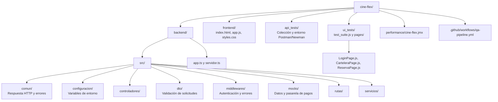

# CineFlex


CineFlex es una aplicación de demostración para el flujo de reserva de cine. Contiene una interfaz web para iniciar sesión, consultar la cartelera, seleccionar asientos, procesar un pago simulado y consultar la confirmación de la reserva. El backend expone una API REST con Express y TypeScript, emplea datos en memoria y una pasarela de pagos simulada, y dispone de artefactos de pruebas de API, interfaz y rendimiento.

**Repositorio Git:** <https://github.com/Zexter27/cine-flex.git>

## 1. Contexto y Arquitectura de Componentes

La aplicación integra una interfaz estática servida por el backend, una API HTTP y datos simulados. Express publica los archivos de `frontend/`, registra las solicitudes y aplica las rutas, la validación de datos y el manejo de errores. La información de películas, funciones, salas, asientos y el usuario de demostración reside en los mocks del backend; no se configura una base de datos en los archivos incluidos en este proyecto.

### Componentes y estructura de directorios



### Flujo funcional

1. El navegador carga la interfaz desde `http://localhost:3000/`.
2. `POST /login` valida las credenciales de demostración y devuelve un token JWT.
3. `GET /cartelera` requiere un token Bearer válido. `GET /asientos/disponibles` publica el listado de asientos disponibles.
4. `POST /reserva` y `POST /pagos/mock` validan los datos recibidos y delegan el procesamiento en la pasarela de pagos simulada.
5. La interfaz muestra los resultados del flujo de reserva y las pruebas automatizadas verifican contratos HTTP, interacciones de usuario y carga.

### Rutas HTTP disponibles

| Método | Ruta | Acceso | Propósito documentado |
|---|---|---|---|
| `GET` | `/health` | Público | Devuelve el estado de disponibilidad del servicio. |
| `POST` | `/login` | Público | Valida el inicio de sesión y genera el token JWT. |
| `GET` | `/cartelera` | Requiere Bearer JWT | Consulta la cartelera de películas simulada. |
| `GET` | `/asientos/disponibles` | Público | Consulta asientos disponibles; acepta el parámetro opcional `funcionId`. |
| `POST` | `/reserva` | Requiere Bearer JWT | Valida y procesa una reserva mediante la pasarela de pagos simulada. |
| `POST` | `/pagos/mock` | Requiere Bearer JWT | Ejecuta el mismo controlador de procesamiento simulado que la ruta de reserva. |

## 2. Requisitos Previos (Prerequisites)

| Herramienta | Versión declarada | Uso |
|---|---|---|
| Node.js | `20` en GitHub Actions. El README anterior del repositorio indicaba `18` o superior para desarrollo local. | Ejecutar el backend y las suites JavaScript. |
| npm | `9` o superior en el README anterior del repositorio; la versión exacta no está fijada en los manifiestos incluidos. | Instalar dependencias y ejecutar scripts. |
| TypeScript | `^5.8.3` en `backend/package.json`. | Comprobación de tipos del backend. |
| Google Chrome | Requerido por la suite Selenium; no se fija una versión del navegador en los archivos incluidos. | Navegador automatizado en modo headless. |
| ChromeDriver | `^140.0.0` en `ui_tests/package.json`. | Control del navegador Chrome. |
| Selenium WebDriver | `^4.35.0` en `ui_tests/package.json`. | Automatización de la interfaz y ejecución del patrón Page Object Model. |
| Newman | `^6.2.1` en `api_tests/package.json`. | Ejecución de la colección Postman por línea de comandos. |
| Apache JMeter | `5.6.3` en `performance/cine-flex.jmx`. | Ejecución del plan de carga y estrés. El README anterior del repositorio indicaba `5.5` o superior. |
| Java Runtime Environment | `8` o superior en el README anterior del repositorio; la versión exacta no está fijada en el plan JMeter. | Entorno de ejecución de JMeter. |
| Git | Requerido para clonar el repositorio. | Control de versiones y descarga del código. |

## 3. Configuración Rápida y Ejecución (Local Setup)

### Clonar el repositorio

```bash
git clone https://github.com/Zexter27/cine-flex.git
cd cine-flex
```

### Configurar el entorno

Cree el archivo `.env` en la raíz a partir del archivo de ejemplo:

```bash
cp .env.example .env
```

El backend busca la configuración en `.env` dentro de su directorio de ejecución y, como alternativa, en el directorio raíz del repositorio. El archivo de ejemplo contiene las variables documentadas en la sección 4.

### Instalar dependencias e iniciar el backend

Desde la raíz del repositorio, ejecute:

```bash
cd backend
npm ci
npm run comprobar
npm start
```

El comando `npm run comprobar` ejecuta `tsc --noEmit` para verificar los tipos de TypeScript. `npm start` inicia el servidor HTTP según el puerto definido en `PORT`.

### Acceder a la aplicación

Abra <http://localhost:3000/> en el navegador. El backend sirve directamente los archivos estáticos de `frontend/`; el proyecto no requiere un comando de servidor independiente para esa carpeta.

Las credenciales de demostración utilizadas por los mocks y por las pruebas son:

| Campo | Valor |
|---|---|
| Correo | `edwin@gmail.com` |
| Contraseña | `edwin1234567` |

## 4. Gestión de Configuración (Environment Variables)

Copie `.env.example` a `.env` y conserve los nombres de variables definidos por el backend.

```dotenv
PORT=3000
JWT_SECRET=cambia-esta-clave-local-por-una-de-al-menos-32-caracteres
JWT_DURACION_SEGUNDOS=3600
LIMITE_CUERPO_BYTES=10240
MORGAN_FORMAT=dev
FRONTEND_PATH=../frontend
```

| Variable | Tipo | Descripción | Valor por Defecto |
|---|---|---|---|
| `PORT` | Entero | Puerto HTTP del servidor. El backend valida que se encuentre entre `1` y `65535`. | `3000` |
| `JWT_SECRET` | Cadena | Secreto utilizado para firmar y verificar los tokens JWT. El backend exige al menos 32 caracteres. | `cambia-esta-clave-local-por-una-de-al-menos-32-caracteres` |
| `JWT_DURACION_SEGUNDOS` | Entero | Duración de los tokens JWT expresada en segundos. Debe ser mayor que cero. | `3600` |
| `LIMITE_CUERPO_BYTES` | Entero | Tamaño máximo del cuerpo JSON de una solicitud, en bytes. Debe ser mayor que cero. | `10240` |
| `MORGAN_FORMAT` | Cadena | Valor de configuración declarado para el registro de solicitudes con Morgan. | `dev` |
| `FRONTEND_PATH` | Ruta relativa | Ruta de la interfaz web respecto del directorio raíz de `backend`. | `../frontend` |

El módulo de configuración requiere los valores definidos, valida los valores numéricos y rechaza el inicio si falta una variable obligatoria o si `JWT_SECRET` tiene menos de 32 caracteres.

## 5. Módulo de Pruebas de API (Postman / Newman)

La colección se encuentra en `api_tests/CineFlex_API_Collection.json` y el entorno local en `api_tests/CineFlex_Environment.json`. El entorno define `baseUrl`, `correoDemo`, `contrasenaDemo` y `token`; la solicitud de inicio de sesión guarda el JWT para las solicitudes posteriores.

### Ejecutar la colección desde la raíz

Con el backend en ejecución, use Newman sin instalación global:

```bash
npx --yes newman run api_tests/CineFlex_API_Collection.json -e api_tests/CineFlex_Environment.json
```

Para generar un reporte JUnit como el publicado por CI:

```bash
mkdir -p reportes
npx --yes newman run api_tests/CineFlex_API_Collection.json \
  -e api_tests/CineFlex_Environment.json \
  --reporters cli,junit \
  --reporter-junit-export reportes/newman.xml
```

También está declarado el script `test` dentro de `api_tests/package.json`. Para ejecutarlo desde esa carpeta, instale sus dependencias y ejecute `npm test`:

```bash
cd api_tests
npm install
npm test
```

### Cobertura de la colección existente

La colección incluye diez solicitudes con aserciones sobre el contrato HTTP y la estructura de las respuestas:

| N.º | Caso | Verificaciones principales |
|---:|---|---|
| 1 | Health check | HTTP `200`, `exito = true`, mensaje no vacío y `datos.estado = disponible`. |
| 2 | Login exitoso | HTTP `200`, identificador y correo del usuario, JWT de tres partes y almacenamiento del token en el entorno. |
| 3 | Cartelera sin token | HTTP `401`, respuesta no exitosa y `datos = null`. |
| 4 | Cartelera con token | HTTP `200`, lista no vacía, estructura básica de películas y tiempo de respuesta inferior a `300 ms`. |
| 5 | Asientos disponibles | HTTP `200`, lista no vacía, identificador de asiento y campo `disponible` booleano. Consulta `funcionId=5`. |
| 6 | Reserva sin token | HTTP `401` y respuesta no exitosa. |
| 7 | Reserva aprobada | HTTP `200`, estado `aprobado`, código `approved`, identificador de transacción, monto y moneda `COP`. |
| 8 | Reserva con correo distinto | HTTP `403` y mensaje de posible actividad sospechosa. |
| 9 | Tarjeta vencida | HTTP `402` y mensaje de tarjeta vencida. |
| 10 | Número de tarjeta no numérico | HTTP `400` y mensaje de validación de la información enviada. |

La colección usa `http://localhost:3000` como URL base. Los escenarios de pago usan la pasarela simulada del backend.

## 6. Módulo de Pruebas de Interfaz de Usuario (Selenium + POM)

La suite se encuentra en `ui_tests/test_suite.js` y sigue el patrón Page Object Model (POM): las clases de `ui_tests/pages/` encapsulan localizadores y acciones de las vistas.

### Ejecutar la suite

Mantenga el backend activo y ejecute desde la raíz:

```bash
cd ui_tests
npm install
npm test
```

La suite construye Chrome con `--headless=new`, `--no-sandbox`, `--disable-dev-shm-usage` y un tamaño de ventana de `1440x1200`. Al terminar, cierra el controlador del navegador. La ejecución imprime los nombres de los casos y finaliza con el mensaje de suite completada si no se produce un error.

### Page Objects

| Archivo | Responsabilidad |
|---|---|
| `pages/LoginPage.js` | Abrir la aplicación, ingresar credenciales, iniciar sesión, leer errores y cerrar sesión. |
| `pages/CarteleraPage.js` | Consultar la vista de cartelera, seleccionar una película, contar tarjetas y navegar atrás. |
| `pages/ReservaPage.js` | Seleccionar un asiento, avanzar al pago, completar datos, confirmar pago y consultar la confirmación. |

### Casos de prueba automatizados

| N.º | Caso | Flujo comprobado |
|---:|---|---|
| 1 | `01_bloqueo_preventivo` | Verifica el mensaje de bloqueo tras tres intentos de inicio de sesión fallidos. |
| 2 | `02_login_exitoso` | Inicia sesión con credenciales de demostración y comprueba la visibilidad de la cartelera. |
| 3 | `03_seleccion_pelicula` | Selecciona una película y espera la vista de asientos. |
| 4 | `04_compra_end_to_end` | Selecciona asiento, completa el pago simulado y espera la confirmación. |
| 5 | `05_cierre_sesion_y_historial` | Cierra sesión y comprueba que el historial no vuelva a mostrar una vista autenticada. |
| 6 | `06_login_nuevo_exitoso` | Realiza un nuevo inicio de sesión. |
| 7 | `07_persistencia_ocupacion_real` | Recorre la selección de asiento, navegación, cierre de sesión y nuevo inicio de sesión. |
| 8 | `08_tarjeta_vencida` | Comprueba la respuesta ante una tarjeta vencida. |
| 9 | `09_cvv_invalido` | Comprueba la validación de CVV. |
| 10 | `10_fondos_insuficientes` | Comprueba la respuesta de fondos insuficientes de la pasarela simulada. |
| 11 | `11_login_timeout` | Comprueba que un inicio de sesión fallido muestre un mensaje de error. |
| 12 | `12_sin_asientos_seleccionados` | Comprueba la validación al continuar sin seleccionar asientos. |
| 13 | `13_navegacion_atras_dentro_login` | Comprueba que la navegación hacia atrás mantenga la vista de inicio de sesión después del cierre de sesión. |
| 14 | `14_navegacion_insegura_sin_token` | Comprueba la vista inicial cuando se abre la aplicación sin token. |
| 15 | `15_cierre_sesion_desde_catalogo` | Cierra sesión desde la cartelera y espera la vista de inicio de sesión. |

## 7. Módulo de Rendimiento (JMeter)

El plan de carga está definido en `performance/cine-flex.jmx`. Los parámetros siguientes proceden del plan JMeter incluido en el repositorio.

| Parámetro | Configuración |
|---|---|
| Versión de JMeter del plan | `5.6.3` |
| Protocolo y host | `http://localhost:3000` |
| Usuarios virtuales (threads) | `500` |
| Ramp-up | `15` segundos |
| Iteraciones por grupo | `1` |
| Comportamiento al fallar una solicitud | Continuar (`continue`). |
| Recolector de resultados | `View Results Tree`. |
| Extracción del token | JSONPath `$.datos.token`, guardado en la variable `mi_jwt`. |
| Cabeceras de solicitud | `Authorization: Bearer ${mi_jwt}` y `Content-Type: application/json`. |

### Secuencia y endpoints evaluados

1. `POST /login`: envía las credenciales de demostración y extrae el JWT de la respuesta.
2. `GET /cartelera`: solicita la cartelera con la cabecera de autorización.
3. `GET /asientos/disponibles`: consulta la disponibilidad de asientos.
4. `POST /reserva`: envía un cuerpo JSON con los datos de tarjeta de prueba, monto, moneda, correo, identificador de función y asiento generado por el plan.

### Ejecución

Para abrir el plan en la interfaz gráfica de JMeter:

```bash
jmeter -t performance/cine-flex.jmx
```

Para ejecutar en modo no gráfico y guardar las muestras en un archivo JTL:

```bash
jmeter -n -t performance/cine-flex.jmx -l performance/cine-flex.jtl
```

El plan contiene configuración de solicitudes y recopilación de muestras; el XML de origen no incluye resultados ejecutados de rendimiento.

## 8. Integración Continua (CI/CD)

El workflow `.github/workflows/qa-pipeline.yml`, con nombre `QA Pipeline`, utiliza GitHub Actions y define un job de backend y pruebas de API.

### Eventos que disparan el workflow

- `push` a la rama `main`.
- `pull_request` dirigido a la rama `main`.
- `workflow_dispatch`, para ejecución manual.

### Flujo automatizado

1. Descarga el repositorio mediante `actions/checkout@v4`.
2. Configura Node.js `20` mediante `actions/setup-node@v4`.
3. Crea `.env` desde `.env.example` y reemplaza `JWT_SECRET` por una clave aleatoria efímera generada durante la ejecución.
4. Instala las dependencias del backend con `npm ci`.
5. Ejecuta `npm run comprobar` para validar TypeScript.
6. Inicia el backend y espera hasta 60 segundos a que responda `GET /health` en `http://localhost:3000/health`.
7. Ejecuta pruebas de humo HTTP para disponibilidad, login inválido, bloqueo tras tres intentos, login válido, cartelera con y sin token, asientos disponibles, reserva sin token y ruta inexistente.
8. Ejecuta la colección Postman con Newman y genera el reporte JUnit en `reportes/newman.xml`.
9. Publica el reporte Newman como artefacto aunque el job falle y publica `backend.log` cuando ocurre un fallo.

El job se ejecuta en `ubuntu-latest`, tiene un límite de 10 minutos, restringe los permisos a `contents: read` y cancela una ejecución anterior del mismo grupo cuando corresponde. El workflow definido automatiza la comprobación de tipos y las pruebas HTTP/API; no contiene pasos de ejecución de Selenium ni de JMeter.

## 9. Entregables y Actividades del Equipo

### Entregables presentes en el repositorio

- **Aplicación:** backend Express/TypeScript (`backend/`) e interfaz web estática (`frontend/`).
- **Pruebas de API:** colección Postman `api_tests/CineFlex_API_Collection.json` y entorno `api_tests/CineFlex_Environment.json`, con diez solicitudes automatizadas.
- **Pruebas de interfaz:** suite `ui_tests/test_suite.js` con 15 casos y tres Page Objects.
- **Pruebas de rendimiento:** plan JMeter `performance/cine-flex.jmx`.
- **Integración continua:** workflow `.github/workflows/qa-pipeline.yml` para la comprobación TypeScript y las pruebas HTTP/API.


